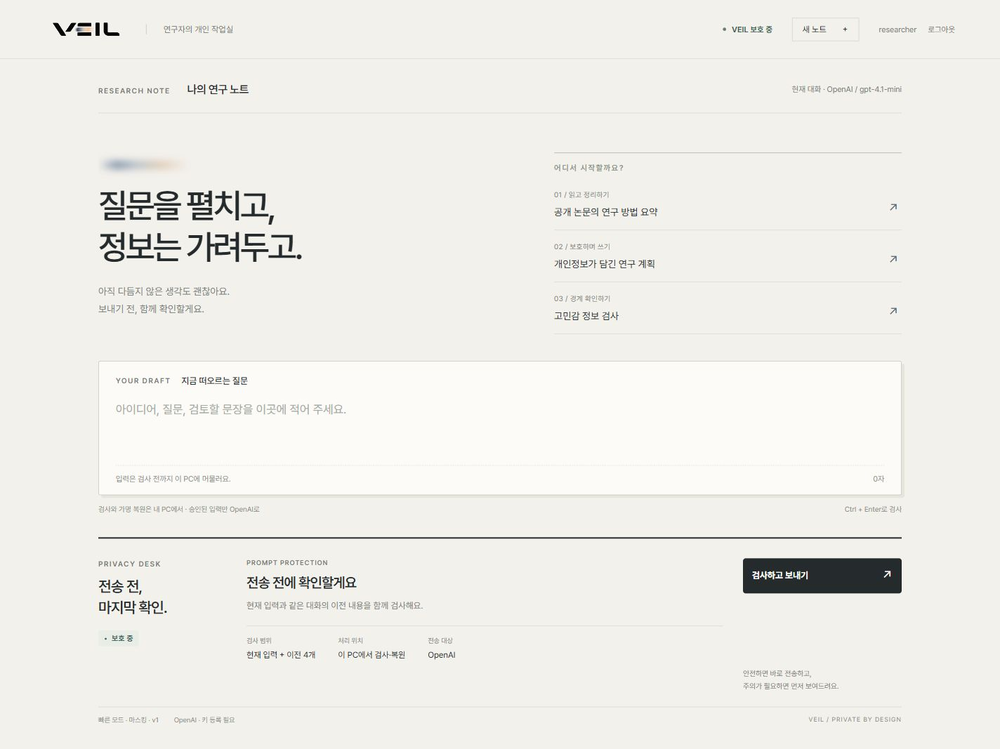
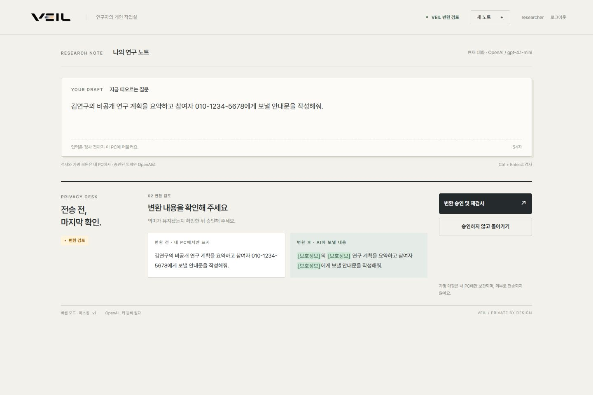

# VEIL · 연구자를 위한 프롬프트 보호 작업실

VEIL은 연구자가 생성형 AI에 프롬프트를 보내기 전에 민감정보를 검사하고, 필요한 경우 마스킹하거나 가명으로 바꿔 전송하는 소프트웨어공학 팀 프로젝트입니다. 연구 책임자는 보안 정책을 정하고 처리 기록을 조회합니다.

**현재 구현은 연구자 PC에서 실행하는 Flask 앱입니다.** 로그인, 대화 누적 검사, 변환 승인과 재검사, 전송 통제, 정책·기록 화면이 연결되어 있습니다. OpenAI 호출 코드와 모의 통신 테스트가 있으며, 유효한 키로 실제 응답을 받는 검증은 저장소 문서 기준으로 남아 있습니다.



## 연구자가 사용하는 흐름

1. **입력하고 검사합니다.** 현재 입력과 같은 노트의 이전 입력 최대 4개를 PC에서 검사합니다.
2. **위험 판정에 따라 처리합니다.** `SAFE`는 전송 조건을 확인한 뒤 전송합니다. `CAUTION`은 변환하거나 5~200자의 사유를 입력해 전송을 요청할 수 있습니다. `BLOCKED`는 그대로 전송할 수 없으며 수정하거나 변환 후 재검사할 수 있습니다. 핵심 키워드를 발견하면 점수와 관계없이 차단합니다.
3. **변환을 검토합니다.** 승인하면 변환문을 재검사합니다. 거절하면 기존 입력을 유지합니다. 입력이나 정책이 바뀌면 이전 분석 결과로 전송할 수 없습니다.
4. **답변을 확인합니다.** 외부 AI에는 전송 조건을 통과한 현재 입력만 전달합니다. 답변에 포함된 가명은 PC에서 복원하며, 마스킹된 값은 복원 대상에서 제외됩니다.



## 모델링 설계와 현재 구현

| 유스케이스 | 현재 코드에서 동작하는 범위 | 최종 설계까지 남은 작업 |
|---|---|---|
| UC-01 · PC 에이전트 로그인 | 로컬 연구자·책임자 계정 인증, 권한 확인, 연속 5회 실패 시 잠금 | 중앙 계정 인증과 연구실별 권한 |
| UC-02 · 프롬프트 전송 | 최신 분석·정책 버전 확인, OpenAI Responses 호출 코드, 응답 표시와 가명 복원 | 실제 키 검증, 공유 락 없이 요청 처리, 실호출 장애 처리 검증 |
| UC-03 · 위험 분석 | 이전 입력 최대 4개와 현재 입력의 키워드·패턴 검사, 핵심 키워드 즉시 차단 | 정밀 문맥 분석, PRECISE 시간 초과 시 FAST 전환, 정책 캐시와 만료 처리 |
| UC-04 · 보안 경고 확인 | 경고 근거 표시, 주의 전송 사유 검증, 차단, 취소 기록 | 차단 후 수정 시 새 `Prompt` 생성, 차단된 전송 요청의 `RJ` 감사 기록 |
| UC-05 · 안전 프롬프트 변환 | 변환 전후 미리보기, 승인 후 재검사, `PRECISE_DEMO`에서 대화별 인물 가명 재사용 | PDF의 변환 규칙(AS/TG)과 정밀 분석·변환 전략 연결 |
| UC-06 · 연구실 보안 정책 설정 | 보호·핵심 키워드, 임계값, 모드 저장 및 버전 갱신 | 연구실별 정책 조회·배포 |
| UC-07 · 보안 기록 조회 | 관리자 화면의 기간·사용자·위험도 검색과 처리 건수 표시 | 연구실별 조회 범위와 PDF의 로그 코드·상세 표시 기준 반영 |
| UC-08 · 로그 보관 정책 | 최소·상세 설정, 보관 기간 1~365일, 자동 삭제 설정 및 로컬 만료 기록 정리 | 중앙 서버 일일 파기, 관련 탐지 기록과 고립된 프롬프트 기록 정리 |

PDF의 최종 구조는 **PC 에이전트 → 중앙 보안 서버 → 외부 AI**입니다. 분석·변환·복원은 PC에서 수행하고, 중앙 서버는 연구실 계정·정책·보안 기록과 외부 AI 연동을 맡도록 설계했습니다. 현재는 같은 PC의 Flask 프로세스가 이 흐름을 연결하고 SQLite의 3개 테이블에 계정·단일 정책·로그를 저장합니다. PDF에서 설계한 중앙 서버와 3NF 7개 테이블은 후속 범위입니다.

원문·변환문·대화·가명 대응표는 실행 중 PC 메모리에 둡니다. 새 노트나 로그아웃 시 대화와 대응표가 초기화됩니다. 현재 SQLite 로그에는 처리 결과·탐지 종류와 건수·사유 입력 여부를 저장합니다. 상세 수준의 요약도 유형별 건수로 구성됩니다. 원문과 자유 입력 사유는 DB에 저장하지 않습니다.

## 로컬에서 실행하기

Python 3.9 이상이 필요합니다. Windows에서는 아래 명령을 실행하거나 `start.bat`를 사용할 수 있습니다.

```powershell
git clone https://github.com/SHI0284/veil.git
cd veil
python -m venv .venv
.\.venv\Scripts\python.exe -m pip install -r requirements.txt
.\.venv\Scripts\python.exe -X utf8 main.py
```

브라우저에서 **http://127.0.0.1:5000**을 엽니다. 최초 실행 시 `data/veil_demo.sqlite3`에 로컬 시연 계정이 생성됩니다.

| 계정 | 아이디 | 비밀번호 |
|---|---|---|
| 연구자 | `researcher` | `veil1234!` |
| 연구 책임자 | `manager` | `veil1234!` |

1. 연구자로 로그인해 **개인정보가 담긴 연구 계획** 예시를 선택하고 **검사하고 보내기 → 변환 미리보기**를 누릅니다. 이 단계까지 API 키 없이 확인할 수 있습니다.
2. 승인하지 않고 돌아가면 기존 입력이 유지되는지 확인합니다. **새 노트**에서 고민감 정보 예시를 검사하면 차단 흐름을 볼 수 있습니다.
3. 책임자로 로그인하면 **보안 정책**, **보안 기록**, **로그 보관 설정**을 확인할 수 있습니다.

서버를 종료할 때는 터미널에서 `Ctrl+C`를 누릅니다. 포트 변경은 `--port 5001`, 브라우저 자동 열기 생략은 `--no-browser`, 개발용 계정 잠금 초기화는 `--reset-demo-locks`를 `main.py` 뒤에 붙여 실행합니다.

## OpenAI 실호출 확인

1. 책임자 계정으로 로그인해 **AI 연결**에서 [OpenAI API 키](https://platform.openai.com/api-keys)를 등록합니다. 기본 모델은 `gpt-4.1-mini`입니다. `OPENAI_API_KEY`와 `OPENAI_MODEL` 환경 변수도 지원합니다.
2. 연구자로 다시 로그인해 민감정보가 없는 공개 질문으로 응답을 확인합니다. 키는 프로세스 메모리에 보관되며, UI에서 등록한 키는 서버 재시작 시 다시 입력해야 합니다.
3. 실제 호출은 현재 승인된 입력만 보내고 `store: false`와 45초 대기 제한을 적용합니다. 이전 대화는 로컬 검사에 사용됩니다. 키가 없으면 안내 오류를 표시합니다. 응답을 받았는지 확정할 수 없는 경우 `SEND_UNKNOWN`으로 처리해 자동 재전송을 막습니다.

실호출은 연결한 계정에 요금이 부과될 수 있습니다. [OpenAI 데이터 처리 안내](https://developers.openai.com/api/docs/guides/your-data)

## 코드와 테스트

| 코드 | 역할 |
|---|---|
| [`main.py`](main.py), [`web.py`](veil_app/web.py) | 로컬 실행, Flask 라우트, 로그인 세션과 역할 확인 |
| [`controller.py`](veil_app/controller.py), [`domain.py`](veil_app/domain.py) | 유스케이스 연결, 프롬프트 상태와 버전, 대화·가명표 |
| [`analysis.py`](veil_app/analysis.py) | 탐지, 위험 판정, 마스킹·가명화 |
| [`gateway.py`](veil_app/gateway.py), [`openai_client.py`](veil_app/openai_client.py) | 전송 직전 검사, OpenAI 호출, 오류 처리 |
| [`storage.py`](veil_app/storage.py), [템플릿](veil_app/templates), [`app.js`](veil_app/static/app.js) | SQLite 저장과 파기, 연구자·책임자 화면 |

```powershell
python -X utf8 -m unittest discover -s tests -p "test_*.py" -v
node --check veil_app/static/app.js
```

자동 테스트는 업무 로직 19개, Flask 14개, OpenAI 어댑터 10개를 포함합니다. OpenAI 테스트는 모의 통신으로 실행됩니다. Node.js는 JavaScript 문법 검사에 사용합니다. PDF의 FAST 1초·PRECISE 3초·정책 캐시 24시간은 구현 후 검증할 설계 목표입니다.

추가 개발 문서는 [인수인계](docs/TEAM_HANDOFF.md), [팀 개발 계획](docs/TEAM_PLAN.md), [협업 방법](CONTRIBUTING.md), [초기 개발 안내](docs/FIRST_TASKS.md)를 참고하세요. 기본 실행 경로는 Flask이며 이전 Tkinter 구현은 `desktop_legacy.py`에 있습니다. 화면에 쓰는 Pretendard의 [라이선스](veil_app/static/Pretendard-LICENSE.txt)를 포함합니다.
